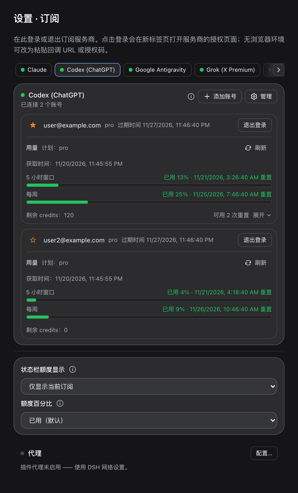
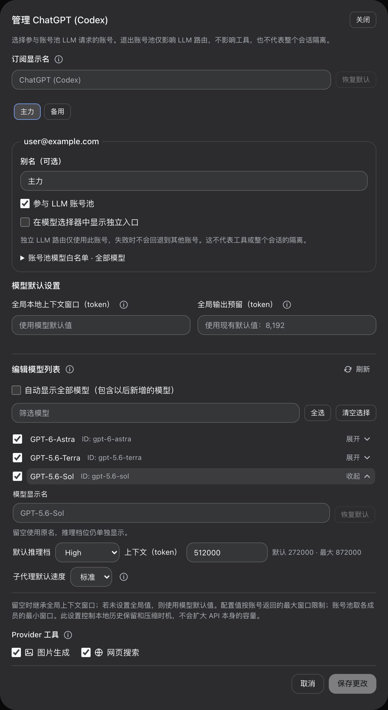
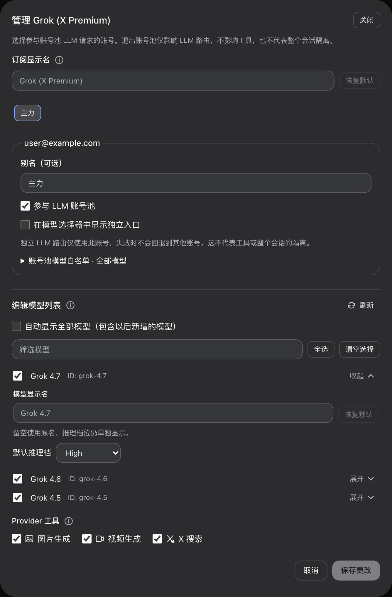
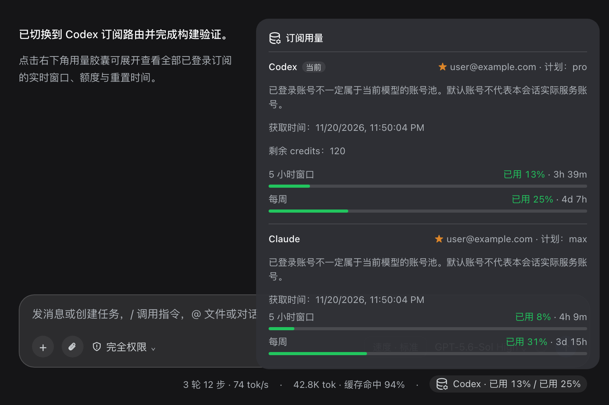
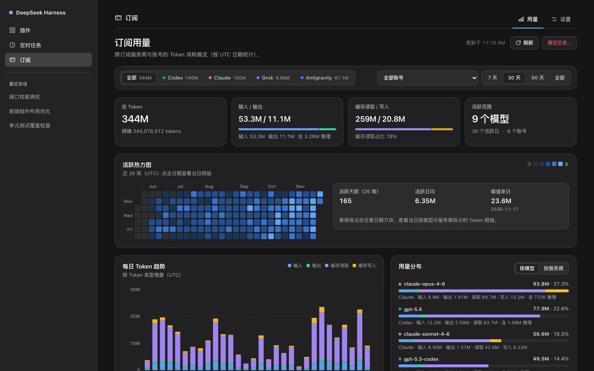
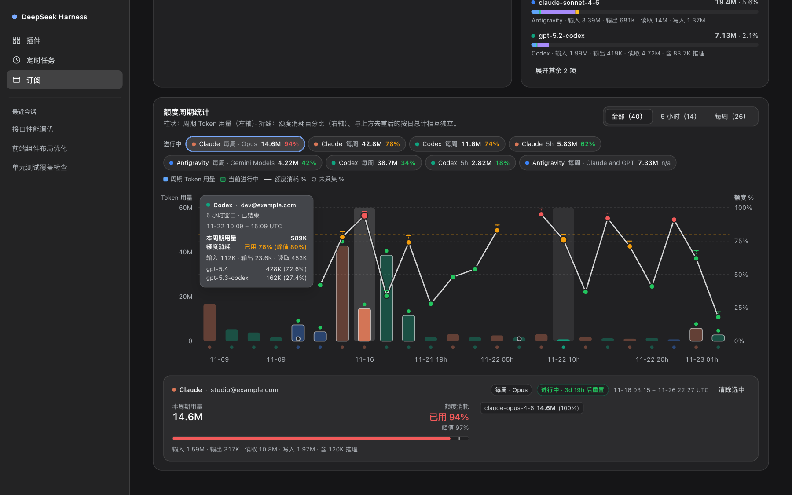

# dsh-plugin-subscriptions [](https://awesome-dsh-plugin.com)

English | [中文](README.zh.md)

Use your **ChatGPT (Codex)**, **Claude**, **Grok (X Premium)**, **GitHub Copilot**, and **Google Antigravity** subscriptions as LLM providers in [DeepSeek Harness](https://github.com/deepseek-ai/deepseek-harness) — no API keys required. Codex, Grok, and Antigravity log in via browser OAuth in the DSH web UI (**Settings → Subscriptions**), Copilot uses the GitHub OAuth device flow, and Claude imports credentials automatically from an existing Claude Code session (macOS Keychain or `~/.claude/.credentials.json`) or falls back to the same browser OAuth flow — no Claude Code CLI required. Tokens are stored at `~/.dsh/plugins/subscriptions/auth.json` (mode `0600`) and refresh automatically.

### Highlights

- **Five subscription providers, zero API keys** — live model catalogs, vision inputs, native reasoning-effort selectors, and Codex Fast mode (`/fast`).
- **Multi-account pools & rate-limit resilience** — automatic per-provider failover (`quota_aware`, `quota_normalized`, or `priority`), Codex purchased-credits fallback, and 429 window waiting with [`@deepseek-ai/dsh-llm-retry`](https://www.npmjs.com/package/@deepseek-ai/dsh-llm-retry).
- **Built-in subscription tools** — Codex `web_search`, Grok `x_search`, GPT/Grok `image_generate` (generation & editing), and Grok `video_generate`.
- **Live quota pill & Usage Dashboard** — composer status-bar quota display plus a sidebar **Subscriptions → Usage** dashboard with a 26-week heatmap, token trends, and quota-cycle charts.
- **Fine-grained customization** — per-provider and per-model display names, visible model filtering, context budgets, default reasoning efforts, Codex subagent default speed, and live Claude prompt-cache TTL switching (`5m` / `1h`).

## Demo

**Settings → Subscriptions** manages per-provider login/logout, live quota windows, and client version visibility with no API keys (settings screenshots use demo accounts and catalog data):



Configure model visibility, custom display names, default reasoning effort, context budget, and Codex subagent default speed together in **Edit model list**, with unified Save and Cancel actions:



Enable or disable Codex web search and image generation, plus Grok image generation, video generation, and X search per provider (changes apply to sessions created after saving):



Logged-in providers join the native session model picker with their live model catalogs:


Models advertising reasoning levels get a native **Effort** selector in the same menu — Codex, Grok, Copilot (auto-rerouting dual-endpoint models to `/responses` when combining tools with effort), and grouped Antigravity models:


Codex models advertising the fast tier get a composer **Speed** toggle (Standard / Fast, `service_tier: priority`) and the `/fast` slash command. Choices are remembered per model across switches and restarts, while subagents follow their own per-model **Subagent default speed** setting unless overridden in that child session:


The composer's stats row shows a compact **subscription usage** pill for the active subscription model's provider (hidden when using non-subscription models). Click it to expand all logged-in providers, accounts (default account starred), reset times, stale status, and Codex credit balances. Both **Status-bar quota display** (`Current subscription only` / `Hidden`) and **Quota percentages** (`Used` / `Remaining`) are configurable in **Settings → Subscriptions**, saved per browser, synced across tabs, and share connection-local usage reads without extra upstream polling — see [Usage Tracking & Dashboard](docs/usage-tracking.md) for cache and refresh semantics.



Open **Subscriptions** from the DSH sidebar for the unified **Usage** (default) and **Settings** tabs (older hosts without sidebar panels keep **Settings → Subscriptions**). The **Usage Dashboard** aggregates input, output (including reasoning without double-counting), cache-read, and cache-write tokens across **Codex**, **Claude**, **Grok**, and **Antigravity** (Copilot is not tracked), filterable by provider, account (including signed-out historical accounts), and time range (`7D`, `30D`, `90D`, `All`):

- **Overview & trends** — KPI cards, a **26-week UTC calendar heatmap** (click any day for per-model/provider details), a daily stacked token trend chart, and a ranked **By Model / By Provider** breakdown.
- **Quota cycles** — a dual-axis combo chart comparing each 5-hour or weekly cycle's token consumption against observed quota utilization `%`, with active-cycle pills and an inline inspector.





Usage from DSH sessions before tracking began is read once from the session history and saved as per-provider UTC daily totals; it appears in the **All accounts** view only. Aggregate counts and cycle metadata are stored locally under `~/.dsh/plugins/subscriptions/usage/` (mode `0600`) — never prompts, credentials, or per-request logs. **Clear history** clears this plugin's local history for one or all providers without affecting sessions, accounts, or live quota. See [Usage Tracking & Dashboard](docs/usage-tracking.md).

The `image_generate` tool renders generated and edited images inline in the conversation:


Its `provider` argument picks the backend — the same prompt via GPT (`gpt-image-2`, top) and Grok (`grok-imagine-image-2.0`, bottom):


The `video_generate` tool plays generated MP4 clips inline:


## Providers

| Route | Subscription | Models & Auth | Usage Telemetry |
|-------|--------------|---------------|-----------------|
| `codex` | ChatGPT Plus / Pro | Live catalog from `chatgpt.com/backend-api/codex/models`; browser OAuth | 5-hour, weekly, per-model weekly windows, plan & credits (`wham/usage`) |
| `claude` | Claude Pro / Max | Live catalog from `api.anthropic.com/v1/models`; Claude Code credential import or browser OAuth | 5-hour, weekly & per-model weekly windows (`api.anthropic.com/api/oauth/usage`) |
| `grok` | X Premium (xAI) | Live chat catalog from `api.x.ai/v1/models` + Grok CLI reasoning efforts & context tiers; browser OAuth | Shared weekly pool & tier (`cli-chat-proxy.grok.com/v1/billing`) |
| `copilot` | GitHub Copilot | Live catalog from `api.githubcopilot.com/models` (`/chat/completions` & `/responses`); GitHub OAuth device flow | Not exposed by Copilot |
| `antigravity` | Google Antigravity | Live catalog from `v1internal:fetchAvailableModels` (`generateContent` / `streamGenerateContent`); browser OAuth | Shared Gemini / Claude+GPT / Argon quota groups (`retrieveUserQuotaSummary`) + plan/credits (`loadCodeAssist`) |

> **Note on Google Antigravity:** Google Antigravity is **disabled by default** (including after upgrading, while preserving existing local credentials and settings) due to high account-suspension (ToS) risk and upstream HTTP 429 rejections on native DSH chat requests. Even if enabled manually via the confirmation prompt in **Settings → Subscriptions**, chat models currently cannot be used — it is effectively limited to checking account usage while waiting for an official approach.

Only logged-in providers appear in the model picker; catalogs refresh on login/logout, on startup (skipping snapshots newer than 5 minutes), every 60 minutes, or on demand via **Edit model list → Refresh**. Vision-capable models declare `['text', 'image']` input modalities and translate image attachments to each provider's wire format.

### Built-in tools

Registered automatically when the corresponding provider is enabled (configurable per provider in **Edit model list → Provider tools**, applying to new sessions):

- **`web_search` provider (Codex)** — uses Codex's hosted web search through DSH's native `web_search` tool and citation UI, following the default Codex account and plugin proxy. It registers as a candidate behind the host's `web` seam (auto-selected when alone, or chosen via `web.searchProvider` alongside others); turning **Web search** off withdraws only this candidate.
- **`x_search` (Grok)** — xAI's hosted X search returning `{ answer, citations }`.
- **`image_generate` (ChatGPT or Grok)** — `gpt-image-2` via Codex or `grok-imagine-image-2.0` via xAI. `provider` selects `gpt` (default) or `grok`, falling back if the preferred provider is logged out. Pass `referenceImages` (1–5 complete DSH attachment references from uploads, `read_image`, or previous generations; local paths are not references) to edit existing images via Codex `/backend-api/codex/images/edits` or Grok `/v1/images/edits`. Outputs save to `~/.dsh/plugins/subscriptions/images/`. Generation and editing share same-provider multi-account failover (see [Image Account Scheduling](docs/image-account-pool.md)).
- **`video_generate` (Grok)** — `grok-imagine-video-1.5` via `api.x.ai/v1/videos` (async submit + poll), supporting duration (1–15 s), aspect ratio, resolution, and image-to-video (`image_url`). MP4s save to `~/.dsh/plugins/subscriptions/videos/` and play inline.

For provider-specific wire details, Codex/Claude client-version discovery, Claude extended thinking replay & prompt-cache TTL, Copilot dual-wire routing, and Antigravity schema/endpoint handling, see [Provider Guide](docs/providers.md) and [Antigravity Output Images](docs/antigravity-output-images.md).

## Install

> **DSH compatibility:** Requires DSH `>=0.2.0-rc.2` (DSH `0.1.x` is no longer supported). See [Development & DSH compatibility](docs/development.md) for peer-range policy.

Install from npm (prebuilt artifacts, no build script permission needed):

```sh
dsh plugin --profile web add dsh-plugin-subscriptions
```

Or install from GitHub sources:

```sh
dsh plugin --profile web add github:V1ki/dsh-plugin-subscriptions
```

Git installs compile on install, so pnpm prompts you to allow this package's build script in the profile's `pnpm-workspace.yaml` (only grant this to packages you trust), then re-run `add`:

```yaml
allowBuilds:
  dsh-plugin-subscriptions: true
```

From a local checkout:

```sh
git clone https://github.com/V1ki/dsh-plugin-subscriptions.git
cd dsh-plugin-subscriptions && pnpm install && pnpm build
dsh plugin --profile web add ./dsh-plugin-subscriptions
```

Headless usage without installing into a profile (log in via the web UI first — the token file is shared):

```sh
cp overlay.example.yml overlay.yml   # set name: to this checkout's absolute lib/index.js path
dsh --profile headless --patch <checkout>/overlay.yml "your task"
```

## Update

Installed from npm:

```sh
dsh plugin --profile web update --latest dsh-plugin-subscriptions
```

Installed from GitHub: re-run `dsh plugin --profile web add github:V1ki/dsh-plugin-subscriptions` to re-fetch and rebuild. From a linked local checkout, run `git pull && pnpm build`.

Restart `dsh web` after updating so the new version loads.

## Use

1. Start `dsh web` and open the printed URL.
2. Open **Settings → Subscriptions** and click **Connect** on a provider:
   - **Claude** imports credentials immediately if you have logged into Claude Code before; otherwise it uses browser OAuth.
   - **Codex**, **Grok**, and **Antigravity** authorize in a browser tab (expand the manual fallback to paste the callback URL or code on headless hosts).
   - **Copilot** displays a GitHub device code to enter at `github.com/login/device`.
3. In any session, open the model picker (`/model`) and select a model under your connected subscription. Logged-out providers stay out of the picker and direct requests fail cleanly with `MISSING_CREDENTIAL`.

### Multiple accounts & model pools

Every provider supports multiple accounts via **Add account** (Claude offers **Browser authorization** and **Import Claude Code** separately so OAuth accounts refresh independently without colliding on the CLI Keychain). Accounts are keyed by identity (email / login, or workspace+user for Codex); the ★ default account serves direct routes.

When a provider has **two or more accounts**, the picker shows the deduplicated union of their catalogs: shared models automatically fail over across accounts (sticky per session to preserve prompt caches), while account-only models route directly to the account that offers them. All pool strategies skip members whose applicable window is at `≥100%` unless a Codex account still reports remaining purchased credits — credit-funded Codex accounts remain available as a last resort after accounts with included quota.

Open **Settings → Subscriptions → provider → Manage** to set account aliases, pool participation, model allowlists, and independent single-account model entries (which stay bound to one account without failover). See [Account & Model Management](docs/account-management.md) and [Model Pools & Rate Limits](docs/pool-and-rate-limits.md).

### Display names, visible models, effort & speed

- **Subscription & model display names** — edit the provider display name at the top of **Manage** and per-model names in **Edit model list** (single-line, up to 80 characters, saved in `provider-settings.json`). Subscription names also update provider group headers in the native model picker. Clear a name or choose **Reset to default** to restore defaults; provider/model IDs and routing are unaffected.
- **Edit model list** — filter visible models (automatic discovery by default, or save an explicit selection; hidden models remain usable by existing sessions), configure default reasoning effort (**Follow provider** or override, intersected across pool members), set Codex token context budgets or Grok `context_windows` tiers (local DSH compaction budget only), set Codex **Subagent default speed**, toggle provider tools (Codex `web_search` and `image_generate`; Grok `image_generate`, `video_generate`, and `x_search`), or click **Refresh** to reload the live catalog immediately. All edits share one **Save changes / Cancel** pair.
- **Remembered Codex speed** — the composer **Speed** toggle and `/fast` remember your last successful choice per underlying model across switches and restarts (`model-speeds.json`), independently of subagent defaults.
- **Antigravity effort grouping** — Antigravity groups `Low` / `Medium` / `High` catalog variants into one picker entry with native effort controls (preferring `High → Medium → Low` by default; concrete model IDs remain callable).

### Usage badge & dashboard

- **Composer pill** — shows up to two percentages for a single-account provider (5-hour first, weekly second) or an account count for multi-account providers; click to inspect every provider, account, reset time, and Codex credit balance.
- **Display preferences** — **Settings → Subscriptions → Status-bar quota display** (`Current subscription only` / `Hidden`) and **Quota percentages** (`Used` / `Remaining`) save locally in the browser and sync across tabs without affecting routing or exhaustion guards.
- **Usage Dashboard** — open **Subscriptions** in the sidebar to view KPIs, the 26-week heatmap, daily token trends, and 5-hour/weekly quota cycles across Codex, Claude, Grok, and Antigravity, or clear local plugin usage history. See [Usage Tracking & Dashboard](docs/usage-tracking.md).

## Configure

Core plugin configuration in your DSH profile:

```yaml
- id: llm-subscriptions
  name: dsh-plugin-subscriptions
  config:
    providers: [codex, claude]        # subset; default all five (antigravity disabled by default in UI)
    streamIdleTimeoutMs: 300000
    claudePromptCacheTtl: 5m          # Claude prompt-cache TTL: 5m (default) or 1h (also live-toggleable in Manage)
    claudeDeferTools: []              # Claude: literal tool names or prefix* patterns sent with defer_loading
    rateLimit:
      wait: true                      # wait out disclosed 429 reset windows (default)
      maxWaitMs: 21600000             # 6 h ceiling (covers a 5-hour session window)
    models:                           # optional catalog overrides
      codex:
        - { id: gpt-5.6-sol, name: GPT-5.6 Sol, contextWindow: 272000, inputModalities: [text, image] }
      copilot:                        # manual entries disable Copilot catalog discovery
        - { id: gpt-5.6-sol, wire: responses }   # copilot only: pin chat-completions or responses
    pool:
      enabled: true                   # default; active when a provider has ≥2 accounts
      strategy: quota_aware           # priority | quota_aware | quota_normalized
      switchMargin: 2                 # hysteresis factor for quota_aware / quota_normalized
      autoAccounts: true              # automatically pool shared catalog models across accounts
      families:                       # optional explicit same-provider account list for a model
        claude-sonnet-5:
          - { provider: claude, model: claude-sonnet-5 }
          - { provider: claude, account: bob@example.com, model: claude-sonnet-5 }
      tiers:                          # optional extra cross-model fallback rows in the picker
        smart:
          - { provider: claude, model: claude-sonnet-5 }
          - { provider: codex, model: gpt-5.6-sol }
          - { provider: grok, model: grok-4.6 }
```

To automatically wait out a disclosed 429 rate-limit window when a single account or an entire pool is cooling down (up to `rateLimit.maxWaitMs`), include [`@deepseek-ai/dsh-llm-retry`](https://www.npmjs.com/package/@deepseek-ai/dsh-llm-retry) in your profile composition:

```yaml
- name: '@deepseek-ai/dsh-llm-retry'
```

Where to find detailed configuration and tuning references:

- **Full YAML schema, environment variables & `~/.dsh/plugins/subscriptions/` storage layout** → [Configuration & Storage](docs/configuration-and-storage.md)
- **Pool strategies (`priority`, `quota_aware`, `quota_normalized`), Codex credits fallback, cooldowns, 429 waiting & Codex reset cards** → [Model Pools & Rate Limits](docs/pool-and-rate-limits.md)
- **Provider-specific options & protocol quirks** (`claudePromptCacheTtl` — also adjustable without restart under **Settings → Subscriptions → Claude → Manage → Prompt cache lifetime**, `claudeDeferTools`, Claude extended thinking replay, Copilot `wire`, `codexClientVersion`, Antigravity OAuth & endpoint fallback) → [Provider Guide](docs/providers.md)

### Proxy

Prefer DSH's host-managed proxy (`HTTP_PROXY` / `HTTPS_PROXY` / `ALL_PROXY` and `NO_PROXY` in your launch environment or `$DSH_HOME/.env`; see the [DSH network proxy guide](https://github.com/deepseek-ai/deepseek-harness/blob/dsh-v0.1.3-alpha.1/docs/user/guide/network-proxy.md)), then restart DSH and **disable the plugin proxy**. Note that environment proxy credentials are inherited by child commands, unlike the plugin's private config.

An optional per-plugin override remains available in **Settings → Subscriptions → Proxy → Configure…** for subscription-only routing (covering token exchanges, model streams, usage lookups, catalog discovery, and `web_search` / `x_search` / `image_generate` / `video_generate`). Configure the HTTP(S) proxy URL (`http://127.0.0.1:7890`), optional username/password (saved in `~/.dsh/plugins/subscriptions/proxy.json`, mode `0600`, never returned to the browser), and optional comma-separated bypass hosts, then verify with **Test**. Changes apply immediately without restarting; disabled/bypassed requests fall back to DSH's global fetch routing (use host `NO_PROXY` for guaranteed direct connections). Browser OAuth tabs follow your browser/system proxy, and SOCKS proxies are not supported.

## Documentation

- [Documentation Index](docs/README.md) — overview of all guides
- [Account & Model Management](docs/account-management.md) — multi-account Manage panel, aliases, pool allowlists, independent entries, display names & Claude cache TTL toggle
- [Configuration & Storage](docs/configuration-and-storage.md) — complete YAML schema, environment variables & `~/.dsh/plugins/subscriptions/` local file layout
- [Provider Guide](docs/providers.md) — protocol details, catalog/version discovery, quirks & advanced options for Codex, Claude, Grok, Copilot & Antigravity
- [Model Pools & Rate Limits](docs/pool-and-rate-limits.md) — scheduling strategies (`priority`, `quota_aware`, `quota_normalized`), credits fallback, cooldowns, 429 window waiting & Codex reset cards
- [Usage Tracking & Dashboard](docs/usage-tracking.md) — Usage Dashboard storage, quota-cycle tracking, status-bar badge caching & multi-process durability
- [Image Account Scheduling](docs/image-account-pool.md) — multi-account failover for `image_generate` (generation & editing)
- [Antigravity Output Images](docs/antigravity-output-images.md) — inline image attachment contract for Antigravity
- [Development Guide](docs/development.md) — DSH compatibility policy, build/test/Playwright regression scripts, repository layout & release workflow

## Develop

```sh
pnpm install
pnpm build     # tsc (lib/) + tsdown (lib/client.js browser bundle)
pnpm test      # node --test over compiled unit specs
```

Restart `dsh web` after building to load changes. See [Development Guide](docs/development.md) for DSH compatibility policy, offline Playwright UI checks, repository layout, and the GitHub Actions release workflow.

## Related Plugins

This plugin supplies model routes and subscription tools; approval policies and sidebar branding live in separate plugins:

- [`dsh-plugin-auto-review`](https://github.com/delef/dsh-plugin-auto-review) — provider-native automatic review for DSH tool approvals. Reproduces Codex Guardian and Grok escalation logic on top of the `codex` / `grok` routes registered here (or compatible routes) via `ctx.llm.stream()`, without touching accounts or credentials. Install with `dsh plugin --profile web add dsh-plugin-auto-review`.
- [`dsh-sidebar-session-provider-icon`](https://github.com/prgrmrwy/dsh-sidebar-session-provider-icon) — draws the brand logo of the selected composer model beside each sidebar session title so `codex`, `claude`, `grok`, `copilot`, or aggregator sessions are recognizable at a glance. Reads DSH's model-selection state (with last-request fallback for historical sessions) without calling providers directly. Install with `dsh plugin --profile web add dsh-sidebar-session-provider-icon`.

## License

[MIT](LICENSE)
