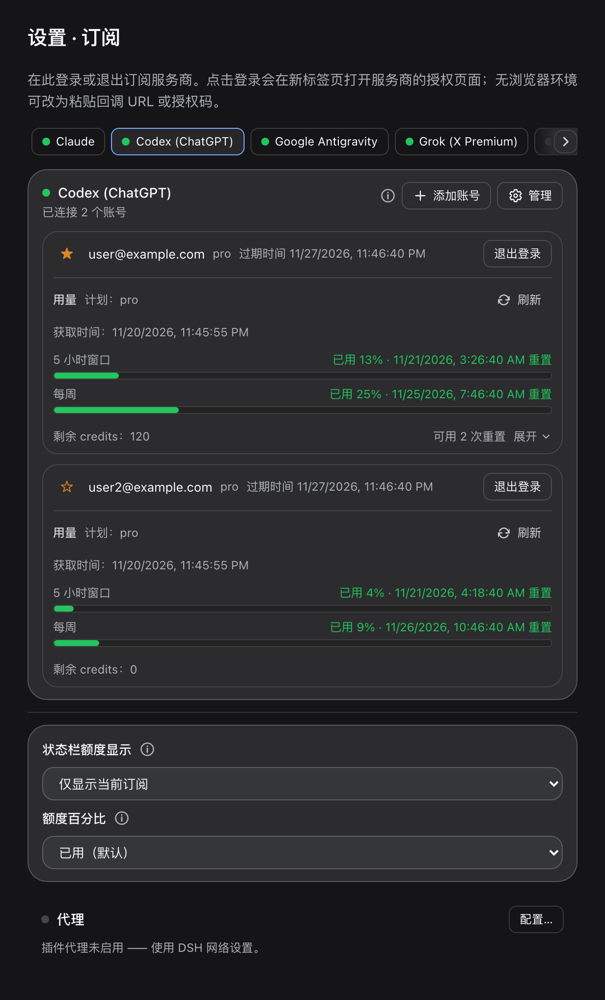
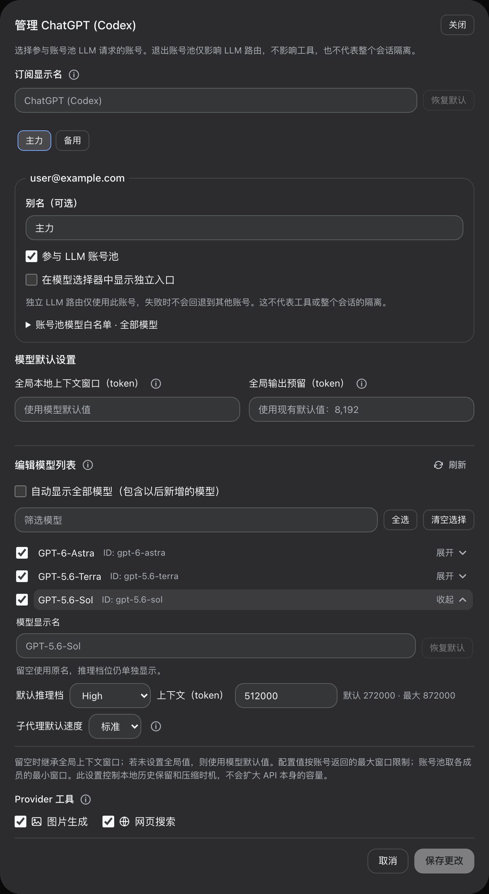
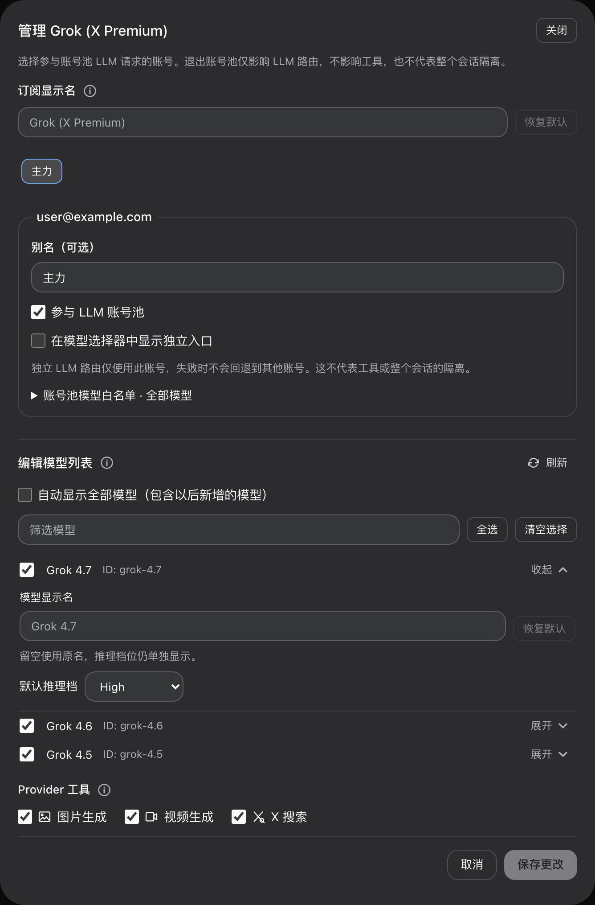
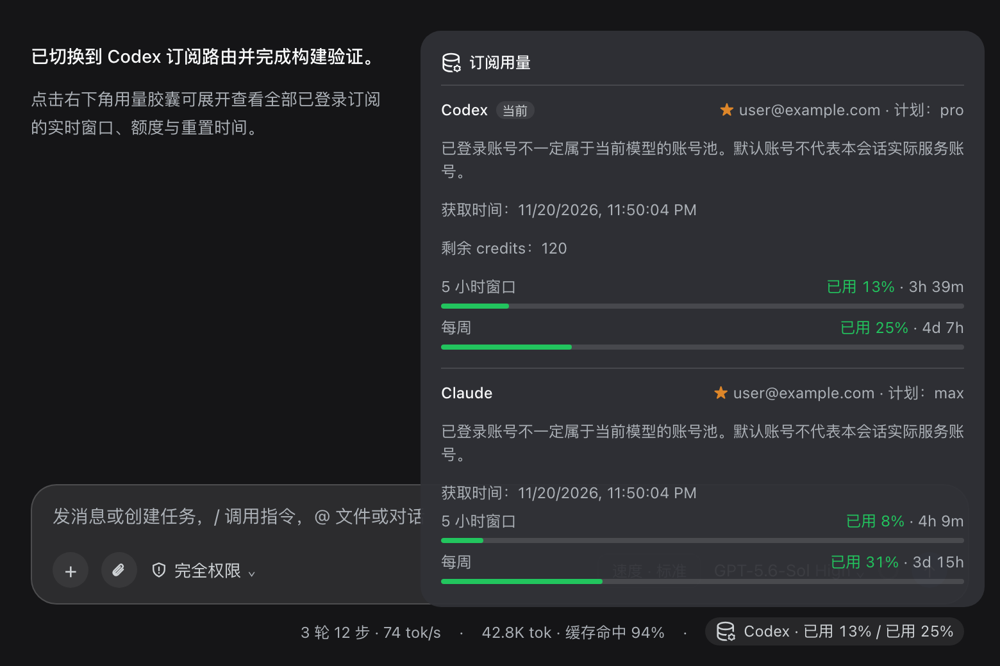
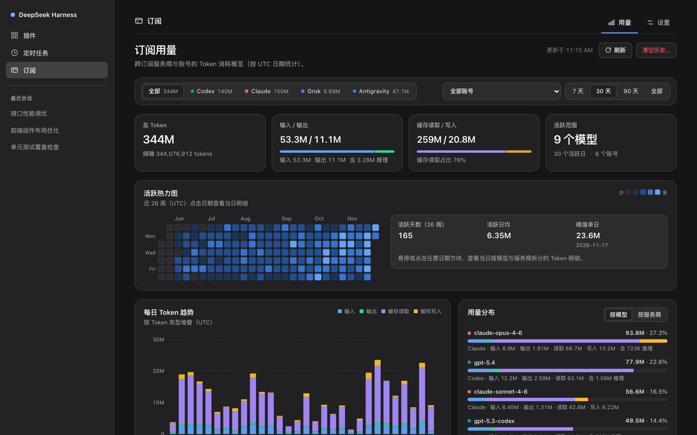
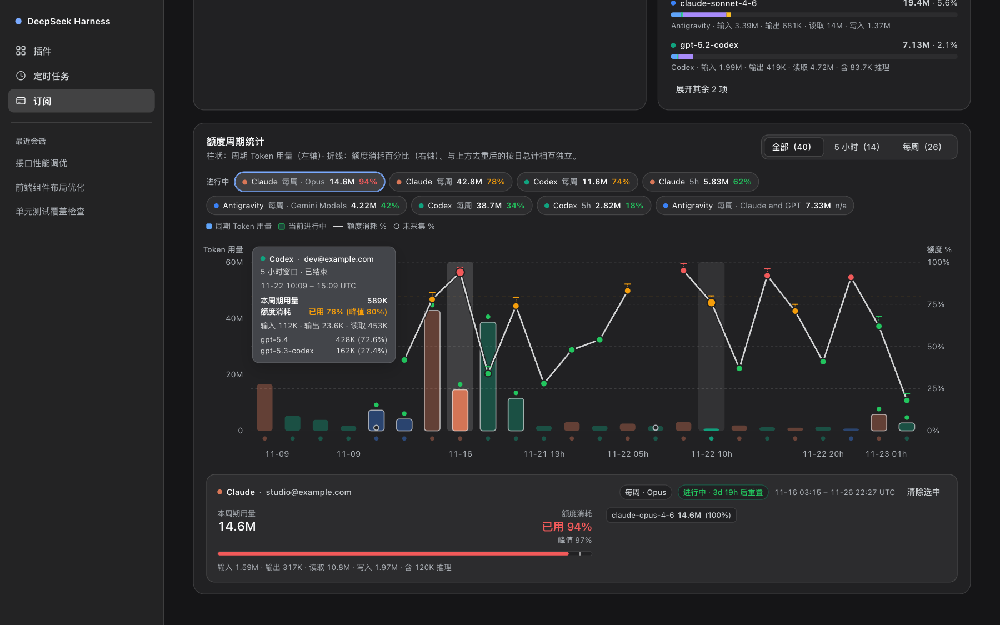

# dsh-plugin-subscriptions [](https://awesome-dsh-plugin.com)

[English](README.md) | 中文

把你的 **ChatGPT (Codex)**、**Claude**、**Grok (X Premium)**、**GitHub Copilot** 和 **Google Antigravity** 订阅当作 [DeepSeek Harness](https://github.com/deepseek-ai/deepseek-harness) 的 LLM provider 使用 —— 无需 API key。Codex、Grok 和 Antigravity 在 DSH Web 界面（**设置 → 订阅**）通过浏览器 OAuth 登录；Copilot 使用 GitHub OAuth 设备码流程；Claude 在本机已有 Claude Code 会话时直接导入凭据（macOS Keychain 或 `~/.claude/.credentials.json`），否则回退到同样的浏览器 OAuth 流程，因此不要求安装 Claude Code CLI。Token 保存在 `~/.dsh/plugins/subscriptions/auth.json`（权限 `0600`），过期自动刷新。

### 核心特性

- **五大订阅服务商，零 API key** —— 实时模型目录、视觉输入、原生推理强度选择器以及 Codex 快速模式（`/fast`）。
- **多账号模型池与限流韧性** —— 同服务商自动故障转移（`quota_aware`、`quota_normalized` 或 `priority`）、Codex 已购 credits 兜底，以及配合 [`@deepseek-ai/dsh-llm-retry`](https://www.npmjs.com/package/@deepseek-ai/dsh-llm-retry) 自动等待 429 限流窗口重开。
- **内置订阅工具** —— Codex `web_search`、Grok `x_search`、GPT/Grok `image_generate`（文生图与图生图编辑）以及 Grok `video_generate`。
- **实时额度徽标与用量看板** —— 输入框状态栏订阅额度胶囊，以及侧边栏 **订阅 → 用量** 看板（26 周热力图、每日趋势与额度周期双轴图）。
- **免重启精细定制** —— 服务商与模型自定义显示名、可见模型过滤、上下文预算、默认推理档、Codex 子代理默认速度，以及 Claude `5m` / `1h` 提示缓存时长即时切换。

## 演示

**设置 → 订阅** 统一管理各服务商的登录/退出、实时额度窗口与客户端版本信息，无需 API key（设置页截图使用演示账号与目录数据）：



在 **编辑模型列表** 中集中配置模型显示开关、自定义显示名、默认推理档、上下文预算与 Codex 子代理默认速度，统一保存或取消：



按服务商开关 Codex 网页搜索与图片生成，以及 Grok 图片生成、视频生成和 X 搜索（工具开关仅影响保存后新建的会话）：



已登录的服务商带着实时模型目录直接进入原生会话模型选择器：


声明了推理等级的模型在同一菜单中提供原生**推理等级**选择器 —— 支持 Codex、Grok、Copilot（双端点模型同时携带工具与推理档时自动改走 `/responses`）以及分组后的 Antigravity 模型：


目录声明了 fast tier 的 Codex 模型会在输入框工具行提供**速度**开关（标准 / 快速，`service_tier: priority`）和 `/fast` 斜杠命令。选择按底层模型跨切换和重启记住；子代理则遵循 **编辑模型列表** 中各自模型的**子代理默认速度**，除非在该子会话内显式覆盖：


输入框下方的统计行会显示当前订阅模型对应服务商的紧凑**订阅用量**胶囊（切换至非订阅模型时自动隐藏）。点击可展开查看所有已登录服务商及账号（默认账号带星标）、重置时间、数据过期状态与 Codex credits 余额。**设置 → 订阅** 中的**状态栏额度显示**（仅显示当前订阅 / 不显示）与**额度百分比**（已用 / 剩余）均保存在浏览器本地并在同源标签页间同步，与设置页共享连接内内存缓存而不额外增加上游轮询 —— 缓存与刷新机制详见 [用量追踪与看板](docs/usage-tracking.zh.md)。



点击 DSH 左侧边栏的 **订阅** 进入统一的 **用量**（默认）与 **设置** 标签页（无侧边栏的旧版宿主继续保留 **设置 → 订阅**）。**用量看板**跨 **Codex**、**Claude**、**Grok** 与 **Antigravity** 聚合记录输入、输出（推理 token 已包含在输出中，不重复计数）、缓存读取与缓存写入 token（暂不统计 Copilot），支持按服务商、账号（含已退出历史账号）及时间范围（`7 天`、`30 天`、`90 天`、`全部`）筛选：

- **总览与趋势** —— KPI 汇总卡片、**26 周 UTC 日历热力图**（点击任意日期下钻查看模型与服务商明细）、每日 Token 堆叠柱状趋势图，以及 **按模型 / 按服务商** 分布视图。
- **额度周期统计** —— 双轴组合图同屏对比每个 5 小时 / 每周周期的 Token 消耗与额度利用率百分比，附带进行中周期快捷胶囊与行内详情卡。





启用统计之前的 DSH 会话用量，会在首次扫描时按事件时间汇总为各服务商的 UTC 逐日数据，仅在 **全部账号** 视图计入。汇总计数与周期元数据保存在本地 `~/.dsh/plugins/subscriptions/usage/`（权限 `0600`），绝不保存提示词、凭据或逐请求日志。**清空历史**可清空单个或全部服务商的插件本地统计，不影响会话、账号或实时额度。详见 [用量追踪与看板](docs/usage-tracking.zh.md)。

`image_generate` 工具将生成和编辑后的图片直接内联展示在对话中：


通过 `provider` 参数选择生图后端 —— 同一条提示词分别走 GPT（`gpt-image-2`，上）与 Grok（`grok-imagine-image-2.0`，下）：


`video_generate` 工具将生成的 MP4 片段直接在对话中内联播放：


## 服务商

| 路由 | 订阅 | 模型目录与认证 | 用量遥测 |
|------|------|----------------|----------|
| `codex` | ChatGPT Plus / Pro | 从 `chatgpt.com/backend-api/codex/models` 实时获取；浏览器 OAuth | 5 小时、每周、按模型每周窗口、套餐与 credits（`wham/usage`） |
| `claude` | Claude Pro / Max | 从 `api.anthropic.com/v1/models` 实时获取；自动导入 Claude Code 凭据或浏览器 OAuth | 5 小时、每周及按模型每周窗口（`api.anthropic.com/api/oauth/usage`） |
| `grok` | X Premium (xAI) | 从 `api.x.ai/v1/models` 实时获取对话模型 + Grok CLI 推理档与上下文档位；浏览器 OAuth | 共享每周额度与订阅档位（`cli-chat-proxy.grok.com/v1/billing`） |
| `copilot` | GitHub Copilot | 从 `api.githubcopilot.com/models` 实时获取（`/chat/completions` 与 `/responses` 双协议）；GitHub OAuth 设备码 | Copilot 未提供用量接口 |
| `antigravity` | Google Antigravity | 从 `v1internal:fetchAvailableModels` 实时获取（`generateContent` / `streamGenerateContent`）；浏览器 OAuth | 共享 Gemini / Claude+GPT / Argon 额度组（`retrieveUserQuotaSummary`）与档位/积分（`loadCodeAssist`） |

> **关于 Google Antigravity 的说明**：由于直连上游私有端点存在较高的账号封禁（ToS）风控，且上游会对 DSH 原生对话请求直接返回 HTTP 429，**Google Antigravity 默认禁用**（升级后同样默认关闭，本地凭据与配置会保留）。如需使用，需在 **设置 → 订阅** 中手动弹框确认启用；即使启用，目前对话模型也无法正常使用，实际仅可用于查看账号用量，等待官方可行方案。

只有已登录的服务商才会出现在模型选择器中；目录在登录/退出、插件启动（跳过 5 分钟内已更新的缓存）、每 60 分钟自动检查或点击 **编辑模型列表 → 刷新** 时更新。支持视觉的模型会声明 `['text', 'image']` 输入模态，并将图片附件转换为对应服务商的协议格式。

### 内置工具

随对应服务商启用而自动注册（可在 **编辑模型列表 → Provider tools** 中按服务商开关，对保存后新建的会话生效）：

- **`web_search` 搜索提供商（Codex）** —— 通过 DSH 原生 `web_search` 工具与引用界面调用 Codex 托管网页搜索，复用默认 Codex 账号和插件代理配置。它作为宿主 `web` 能力位的候选注册（无其他搜索提供商时自动选中，共存时由宿主 `web.searchProvider` 决定）；关闭 Codex 的 **Web search** 仅撤回本候选。
- **`x_search`（Grok）** —— xAI 托管的 X 搜索，返回 `{ answer, citations }`。
- **`image_generate`（ChatGPT 或 Grok）** —— 经 Codex 调用 `gpt-image-2` 或经 xAI 调用 `grok-imagine-image-2.0`。`provider` 指定 `gpt`（默认）或 `grok`，首选未登录时自动回退。传入 `referenceImages`（1–5 张完整 DSH 附件引用，来自用户上传、`read_image` 或先前生图结果；本地文件路径不能作为引用）即可通过 Codex `/backend-api/codex/images/edits` 或 Grok `/v1/images/edits` 编辑图片。输出保存到 `~/.dsh/plugins/subscriptions/images/`。生图与改图共用同服务商多账号故障转移（详见 [图片账号调度](docs/image-account-pool.zh.md)）。
- **`video_generate`（Grok）** —— 经 `api.x.ai/v1/videos` 调用 `grok-imagine-video-1.5`（异步提交 + 轮询），支持时长（1–15 秒）、宽高比、分辨率与图生视频（`image_url`）。MP4 保存至 `~/.dsh/plugins/subscriptions/videos/` 并内联播放。

各服务商协议细节、Codex/Claude 客户端版本自动探测、Claude 扩展思考回放与提示缓存时长、Copilot 双协议路由及 Antigravity Schema/端点策略，详见 [服务商指南](docs/providers.zh.md) 与 [Antigravity 输出图片契约](docs/antigravity-output-images.zh.md)。

## 安装

> **DSH 兼容性**：要求 DSH `>=0.2.0-rc.2`（不再支持 DSH `0.1.x`）。Peer 版本范围策略详见 [开发与兼容性指南](docs/development.zh.md)。

从 npm 安装（预构建产物，无需构建脚本授权）：

```sh
dsh plugin --profile web add dsh-plugin-subscriptions
```

或从 GitHub 源码安装：

```sh
dsh plugin --profile web add github:V1ki/dsh-plugin-subscriptions
```

Git 安装会在安装阶段编译源码，pnpm 会提示在 profile 的 `pnpm-workspace.yaml` 中允许该包的构建脚本（仅对信任的包授权），添加后重新执行 `add`：

```yaml
allowBuilds:
  dsh-plugin-subscriptions: true
```

从本地检出安装：

```sh
git clone https://github.com/V1ki/dsh-plugin-subscriptions.git
cd dsh-plugin-subscriptions && pnpm install && pnpm build
dsh plugin --profile web add ./dsh-plugin-subscriptions
```

不安装进 profile 的 Headless 用法（先在 Web 界面完成登录 —— token 文件共用）：

```sh
cp overlay.example.yml overlay.yml   # 将 name: 改为本地检出目录中 lib/index.js 的绝对路径
dsh --profile headless --patch <检出目录>/overlay.yml "你的任务"
```

## 更新

通过 npm 安装：

```sh
dsh plugin --profile web update --latest dsh-plugin-subscriptions
```

通过 GitHub 安装：重新执行 `dsh plugin --profile web add github:V1ki/dsh-plugin-subscriptions` 即可重新拉取并构建。本地 link 检出只需执行 `git pull && pnpm build`。

无论哪种方式，更新后均需重启 `dsh web` 以加载新版本。

## 使用

1. 启动 `dsh web` 并打开终端输出的 URL。
2. 打开 **设置 → 订阅**，点击对应服务商的**连接**：
   - **Claude**：若曾登录过 Claude Code 会立即导入凭据；否则走浏览器 OAuth。
   - **Codex**、**Grok**、**Antigravity**：在打开的浏览器标签页授权（无浏览器环境可展开手动兜底，粘贴回调 URL 或授权码）。
   - **Copilot**：按提示在 `github.com/login/device` 输入设备码。
3. 在任意会话中打开模型选择器（`/model`）选用已连接订阅下的模型。未登录的服务商不会出现在选择器中，直接请求会清晰返回 `MISSING_CREDENTIAL`。

### 多账号与模型池

每个服务商均支持点击**添加账号**登录多个账号（Claude 区分**浏览器授权**与**导入 Claude Code**，使 OAuth 账号独立刷新而不会与 CLI Keychain 冲突）。账号按身份归档（邮箱 / 登录名，Codex 为 workspace+user）；★ 默认账号服务直连路由。

同一服务商登录**两个及以上账号**时，选择器自动展示各账号目录的去重并集：共有模型在账号间自动故障转移（按会话粘性保持 prompt 缓存），单账号独有模型直接路由到对应账号。所有调度策略均会跳过任一适用窗口已达 `≥100%` 的成员，除非该 Codex 账号仍报告有剩余已购 credits —— 依赖 credits 的 Codex 账号会排在所有仍有套餐额度的账号之后作为最后兜底。

在 **设置 → 订阅 → 对应服务商 → 管理** 中可编辑账号别名、自动 Pool 参与范围、模型白名单以及独立账号模型入口（固定绑定单账号，不做故障转移）。详见 [账号与模型管理](docs/account-management.zh.md) 与 [模型池与限流机制](docs/pool-and-rate-limits.zh.md)。

### 显示名、可见模型、推理档与速度

- **订阅与模型显示名** —— 在**管理**顶部修改订阅显示名，在**编辑模型列表**中修改模型显示名（单行，最多 80 字符，存于 `provider-settings.json`）。订阅显示名同步用作原生模型选择器的服务商分组标题；留空或点击**恢复默认**后保存即可还原，不影响 provider/模型 ID 与路由。
- **编辑模型列表** —— 筛选可见模型（默认自动展示全部发现模型，手动保存后转为显式列表，隐藏模型仍可供已有会话使用）、配置默认推理档（**跟随服务商**或按池交集指定）、设置 Codex 上下文 token 预算或 Grok `context_windows` 档位（仅调整 DSH 本地压缩预算）、设置 Codex **子代理默认速度**、开关服务商工具（Codex `web_search` 与图片生成；Grok 图片生成、视频生成与 X 搜索），或点击**刷新**立即拉取最新目录。所有修改共用一组**保存更改 / 取消**按钮。
- **记住 Codex 对话速度** —— 输入框**速度**开关与 `/fast` 按底层模型跨切换与重启记住上次成功选择（`model-speeds.json`），独立于子代理默认速度。
- **Antigravity 推理强度分组** —— 将目录中的 `Low` / `Medium` / `High` 变体合并为单个原生强度选择条目（默认优先 `High → Medium → Low`，旧的具体模型 ID 仍可调用）。

### 额度徽标与用量看板

- **输入框胶囊** —— 单账号服务商显示最多两个百分比（5 小时在前、每周在后），多账号显示已登录账号数；点击展开所有服务商、账号明细、重置时间与 Codex credits 余额。
- **显示偏好** —— **设置 → 订阅 → 状态栏额度显示**（仅显示当前订阅 / 不显示）与**额度百分比**（已用 / 剩余）保存在浏览器本地并在标签页间同步，不影响账号路由与耗尽保护。
- **用量看板** —— 点击侧边栏**订阅**查看跨 Codex、Claude、Grok、Antigravity 的 KPI、26 周热力图、每日趋势与 5 小时/每周额度周期图，或清空插件本地历史。详见 [用量追踪与看板](docs/usage-tracking.zh.md)。

## 配置

DSH profile 中的核心插件配置示例：

```yaml
- id: llm-subscriptions
  name: dsh-plugin-subscriptions
  config:
    providers: [codex, claude]        # 子集；默认启用全部五项（Antigravity 在界面中默认禁用）
    streamIdleTimeoutMs: 300000
    claudePromptCacheTtl: 5m          # Claude 提示缓存时长：5m（默认）或 1h（亦可在管理面板免重启切换）
    claudeDeferTools: []              # Claude：发送 defer_loading 的字面工具名或 prefix* 模式列表
    rateLimit:
      wait: true                      # 等待服务端披露的 429 限流窗口重开（默认开启）
      maxWaitMs: 21600000             # 单次等待上限 6 小时（覆盖 5 小时会话窗口）
    models:                           # 可选的目录覆盖项
      codex:
        - { id: gpt-5.6-sol, name: GPT-5.6 Sol, contextWindow: 272000, inputModalities: [text, image] }
      copilot:                        # 手工条目会关闭 Copilot 目录自动发现
        - { id: gpt-5.6-sol, wire: responses }   # 仅 copilot：固定为 chat-completions 或 responses
    pool:
      enabled: true                   # 默认开启；同一服务商登录 ≥2 个账号时生效
      strategy: quota_aware           # priority | quota_aware | quota_normalized
      switchMargin: 2                 # quota_aware / quota_normalized 的粘性切换滞后倍率
      autoAccounts: true              # 自动把共有目录模型池化到同服务商各账号
      families:                       # 可选：为单个模型显式指定同服务商账号列表
        claude-sonnet-5:
          - { provider: claude, model: claude-sonnet-5 }
          - { provider: claude, account: bob@example.com, model: claude-sonnet-5 }
      tiers:                          # 可选：额外的跨模型回退选择器条目
        smart:
          - { provider: claude, model: claude-sonnet-5 }
          - { provider: codex, model: gpt-5.6-sol }
          - { provider: grok, model: grok-4.6 }
```

如需在单账号或整个账号池均处于冷却时自动等待服务端披露的 429 重开时刻（受 `rateLimit.maxWaitMs` 上限约束），请在 profile 编排中加入 [`@deepseek-ai/dsh-llm-retry`](https://www.npmjs.com/package/@deepseek-ai/dsh-llm-retry)：

```yaml
- name: '@deepseek-ai/dsh-llm-retry'
```

详细配置与进阶机制请参阅专题文档：

- **完整 YAML Schema、环境变量与 `~/.dsh/plugins/subscriptions/` 本地存储布局** → [配置与存储参考](docs/configuration-and-storage.zh.md)
- **模型池策略（`priority`、`quota_aware`、`quota_normalized`）、Codex credits 兜底、冷却分类、429 等待与 Codex 重置卡** → [模型池与限流机制](docs/pool-and-rate-limits.zh.md)
- **服务商专属选项与协议细节**（`claudePromptCacheTtl` —— 亦可在 **设置 → 订阅 → Claude → 管理 → 提示缓存时长** 中免重启修改、`claudeDeferTools`、Claude 扩展思考回放、Copilot `wire`、`codexClientVersion`、Antigravity OAuth 与端点回退）→ [服务商指南](docs/providers.zh.md)

### 代理

推荐优先使用 DSH 宿主统一代理（在启动环境或 `$DSH_HOME/.env` 中配置 `HTTP_PROXY` / `HTTPS_PROXY` / `ALL_PROXY` 与 `NO_PROXY`，参见 [DSH 网络代理指南](https://github.com/deepseek-ai/deepseek-harness/blob/dsh-v0.1.3-alpha.1/docs/user/guide/network-proxy.zh.md)），重启 DSH 后**关闭插件代理**。注意环境变量中的代理凭据会被子命令继承，与插件私有配置文件的边界不同。

插件仍保留可选的独立代理覆盖（**设置 → 订阅 → 代理 → 配置…**），适用于仅订阅相关请求走代理的场景（覆盖 token 交换、模型流式调用、用量查询、目录发现，以及 `web_search` / `x_search` / `image_generate` / `video_generate` 工具）。填写 HTTP(S) 代理地址（如 `http://127.0.0.1:7890`）、可选用户名/密码（密码保存在 `~/.dsh/plugins/subscriptions/proxy.json`，权限 `0600`，永不回传浏览器）和可选逗号分隔绕过列表后，可点**测试**验证。保存后立即生效无需重启；关闭或绕过时回退到 DSH 全局 fetch 路由（需要直连时请配置宿主 `NO_PROXY`）。浏览器 OAuth 页面走浏览器/系统代理，不支持 SOCKS 代理。

## 文档

- [文档索引](docs/README.zh.md) —— 全部技术与使用文档导览
- [账号与模型管理](docs/account-management.zh.md) —— 多账号管理面板、别名、Pool 白名单、独立模型入口、显示名与 Claude 缓存时长切换
- [配置与存储参考](docs/configuration-and-storage.zh.md) —— 完整 YAML 配置项、环境变量与 `~/.dsh/plugins/subscriptions/` 本地文件布局
- [服务商指南](docs/providers.zh.md) —— Codex、Claude、Grok、Copilot 与 Antigravity 的协议细节、目录/版本发现、特性与高级选项
- [模型池与限流机制](docs/pool-and-rate-limits.zh.md) —— 调度策略（`priority`、`quota_aware`、`quota_normalized`）、credits 兜底、冷却规则、429 等待与 Codex 重置卡
- [用量追踪与看板](docs/usage-tracking.zh.md) —— 用量看板本地存储、额度周期追踪、状态栏缓存与多进程持久化
- [图片账号调度](docs/image-account-pool.zh.md) —— `image_generate`（生图与改图）的多账号故障转移机制
- [Antigravity 输出图片契约](docs/antigravity-output-images.zh.md) —— Antigravity 内联图片附件契约
- [开发指南](docs/development.zh.md) —— DSH 兼容性策略、构建/测试/Playwright 回归脚本、目录结构与发布流程

## 开发

```sh
pnpm install
pnpm build     # tsc (lib/) + tsdown (lib/client.js 浏览器 bundle)
pnpm test      # 编译后运行 node --test 单元测试
```

修改后执行 `pnpm build` 并重启 `dsh web` 生效。DSH 兼容性策略、离线 Playwright UI 回归测试、代码目录结构与 GitHub Actions 发布流程详见 [开发指南](docs/development.zh.md)。

## 相关插件

本插件负责提供订阅模型路由与配套工具，审批策略与侧边栏图标由独立插件提供：

- [`dsh-plugin-auto-review`](https://github.com/delef/dsh-plugin-auto-review) —— 面向 DSH 工具审批的 provider 原生自动审查。在本插件注册的 `codex` / `grok` 路由（或兼容路由）之上通过 `ctx.llm.stream()` 复现 Codex Guardian 与 Grok 提权审查逻辑，不接触账号与凭据。安装：`dsh plugin --profile web add dsh-plugin-auto-review`。
- [`dsh-sidebar-session-provider-icon`](https://github.com/prgrmrwy/dsh-sidebar-session-provider-icon) —— 在侧边栏每个会话标题前绘制输入框当前选中模型的品牌 logo，一眼区分 `codex`、`claude`、`grok`、`copilot` 或聚合路由。读取 DSH 自身的模型选择状态（历史会话回退至最近一次请求），不直接请求模型提供商。安装：`dsh plugin --profile web add dsh-sidebar-session-provider-icon`。

## 许可证

[MIT](LICENSE)
